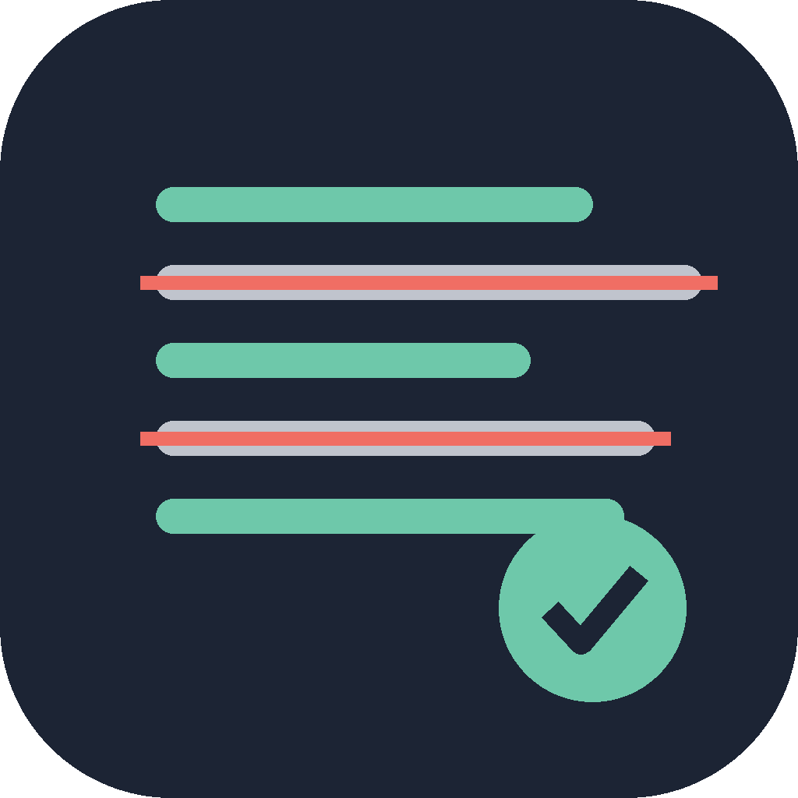

# Codebase Cleanup Review

An agent skill for Claude and Codex that reviews a codebase for code that adds no value. It explains why each piece is unnecessary, what removing it would change, and how to clean it up without changing how the software behaves.

It writes a report first and only changes code you approve.

## What it looks for

The review covers eight categories.

| # | Category | Examples |
|---|---|---|
| 1 | Dead code and dependencies | Unused functions, exports, routes, endpoints, imports and packages |
| 2 | Duplicate logic | Repeated formatters, validators, fetch wrappers and business rules |
| 3 | Unused UI components | Components that are never rendered, unused props, styles and assets |
| 4 | Complexity and overengineering | Wrappers that only pass calls through, interfaces with one implementation, layers that add nothing |
| 5 | Legacy code | Finished feature flags, old shims and polyfills, deprecated APIs |
| 6 | Redundant queries and API calls | N+1 queries, the same data fetched twice, independent calls run one after another |
| 7 | Abandoned files | Files nothing uses, `_old` and `.bak` copies, config for tools you no longer use |
| 8 | Structural issues | Circular dependencies, imports across module boundaries, catch-all utils files |

Every finding in the report comes with evidence for why the code is unnecessary, the impact of removing it, the risks to check first, and where it fits in a phased cleanup plan. Findings are also tagged with [code smells from Refactoring.Guru](https://refactoring.guru/refactoring/smells) where one applies.

## How it works

1. **Baseline.** It records the current test, lint, type-check and build results, so it can tell new failures from existing ones.
2. **Map usage.** It traces every entry point in the repository, such as routes, CLI commands, workers and scripts, and works out what can actually be reached.
3. **Find candidates.** It uses static analysis tools where they're available, and searches the code by hand where they aren't.
4. **Try to disprove each finding.** Before calling anything unused, it checks for dynamic imports, reflection, framework conventions, config files and callers outside the repository.
5. **Rate and prioritise.** Each finding gets a confidence rating and a separate change-risk rating. A finding can be certain and still risky to fix, and risky changes are never marked as ready to do now.
6. **Report.** It writes `CLEANUP_REVIEW.md` with the findings, the evidence and a cleanup plan ordered from safest to riskiest.

When you approve findings, apply mode makes each change as a separate small commit. It checks every commit against the baseline and reverts any that cause a new failure.

## Safety

- **Report only by default.** The report is the only file it writes until you approve changes.
- **Asks before running your code.** Tests, builds and analysis tools that load project config only run with your permission. Tools that would modify files never run during a review.
- **Leaves your work alone.** It won't overwrite uncommitted changes, and if you edit the report, your edits are kept on the next run.
- **Protects sensitive files.** Migrations, generated code, public API contracts, lockfiles and infrastructure files are never proposed for deletion without a review.
- **Treats repository content as information.** Comments, docs and files like `CLAUDE.md` or `AGENTS.md` can explain why code exists, but they can't approve changes or override the skill's rules.

## Requirements

- Claude Code, Codex, or the Claude app with code execution turned on. It works best in Claude Code or Codex, where it can read the whole repository and run tools directly.
- git
- [ripgrep](https://github.com/BurntSushi/ripgrep) (`rg`) is recommended for fast, thorough searches.
- Language analysis tools are optional. If tools like knip, vulture, jscpd or lizard are installed, the skill uses them. The report always says which analyses ran and which couldn't.

## Installation

Pick one option for each tool you use. Installing it more than one way in the same tool gives you duplicate copies of the skill.

### Claude Code plugin

```bash
claude plugin marketplace add KevinLGoh/codebase-cleanup
claude plugin install codebase-cleanup-review@kevinlgoh
```

You can also run `/plugin marketplace add KevinLGoh/codebase-cleanup` inside a session, then `/plugin install codebase-cleanup-review@kevinlgoh`.

### Claude account

This makes the skill available in the Claude app, and it syncs to Claude Code too.

1. In Claude, turn on code execution in **Settings > Capabilities**.
2. Download `codebase-cleanup-review.zip` from the [latest release](https://github.com/KevinLGoh/codebase-cleanup/releases).
3. Go to **Customize > Skills**, click **+**, then **Create skill** and **Upload a skill**, and choose the zip file.

To use it in Claude Code, sign in to Claude Code with the same account (not an API key) and use version 2.1.273 or later. Run `/skills` and you'll find it listed under "claude.ai sync". New skills appear when a session starts.

### Codex plugin

```bash
codex plugin marketplace add KevinLGoh/codebase-cleanup
codex plugin add codebase-cleanup-review@kevinlgoh
```

Restart Codex afterwards so it picks up the new skill.

### By hand

Clone the repository, then copy the skill folder to where your tool looks for personal skills. Claude Code uses `~/.claude/skills/` and Codex uses `~/.agents/skills/`.

```bash
git clone https://github.com/KevinLGoh/codebase-cleanup.git

# Claude Code
cp -r codebase-cleanup/skills/codebase-cleanup-review ~/.claude/skills/

# Codex
cp -r codebase-cleanup/skills/codebase-cleanup-review ~/.agents/skills/
```

## Usage

You can just ask, for example "find dead code in src/api" or "what can we safely delete from this repo".

You can also call the skill directly and add arguments after it. In Claude Code the command is `/codebase-cleanup-review`, or `/codebase-cleanup-review:codebase-cleanup-review` if you installed the plugin. In Codex, type `$` and pick the skill from the list.

| Arguments | What it does |
|---|---|
| (none) | Reviews the whole repository |
| `audit src/billing` | Reviews one directory |
| `dead-code --changed` | Looks for dead code in files changed against the default branch |
| `duplicates`, `simplify`, `queries` or `architecture` | Focuses on one area |
| `apply-approved F-003 F-007` | Applies specific findings you've approved |
| `apply-approved phase:1` | Applies one phase of the cleanup plan |
| `audit --report chat` | Gives a summary in the chat without writing a report file |

Even when you review a single directory, it searches the whole repository for references, so code used from elsewhere isn't reported as unused.

## Configuration

You can add a `.cleanup-review.yml` file to the root of your repository to set exclusions and preferences. Everything in it is optional.

```yaml
report_path: CLEANUP_REVIEW.md
ignore_paths: ["legacy/payments-v1/**", "scripts/one-off/**"]
intentional:
  - path: src/core/ports/
    reason: Hexagonal architecture ports, kept on purpose
known_false_positives:
  - symbol: registerWebhookHandlers
    reason: Loaded by plugin registry at runtime
finding_budget: 40
```

You can also dismiss a finding by saying so in the chat, for example "dismiss F-012, it's used by the mobile app". Dismissed findings aren't reported again unless new evidence turns up.

## Limitations

- **It can't see runtime behaviour.** Static analysis misses production traffic, external callers and code loaded in unusual ways. Findings that depend on these, like public endpoints, are marked for investigation rather than removal.
- **Tool support varies by language.** JavaScript, TypeScript and Python have the best tooling. Other languages rely more on manual searching, and the report says so.
- **Passing tests aren't proof.** They're good evidence, but areas without tests are flagged as unverified.

For your first run, review a repository you know well and check the top findings by hand before using apply mode.

## Repository layout

```text
.claude-plugin/
  plugin.json                  Claude Code plugin manifest
  marketplace.json             Claude Code marketplace for this repository
.codex-plugin/
  plugin.json                  Codex plugin manifest
.agents/plugins/
  marketplace.json             Codex marketplace for this repository
assets/
  icon.png                     Plugin icon
skills/codebase-cleanup-review/
  SKILL.md                     Rules and workflow
  agents/openai.yaml           Display name and default prompt for Codex
  references/
    analysis-tools.md          Analysis tools for each language
    code-smells.md             Code smell catalogue and suggested fixes
    report-template.md         Report structure
```

## Contributing

Issues and pull requests are welcome. Reports of false positives are especially useful, so please include a short example of the code that was flagged.

Before opening a pull request, run `claude plugin validate .` from the repository root. For Codex, check that the plugin still installs with `codex plugin marketplace add .` and `codex plugin add codebase-cleanup-review@kevinlgoh`.

If your change affects how the skill behaves, increase the version number in `.claude-plugin/plugin.json`, `.claude-plugin/marketplace.json` and `.codex-plugin/plugin.json`.

## Credits

- Martin Fowler, [*Refactoring: Improving the Design of Existing Code*](https://martinfowler.com/books/refactoring.html), 2nd edition
- [Refactoring.Guru code smell catalogue](https://refactoring.guru/refactoring/smells)

## Licence

[MIT](LICENSE)
